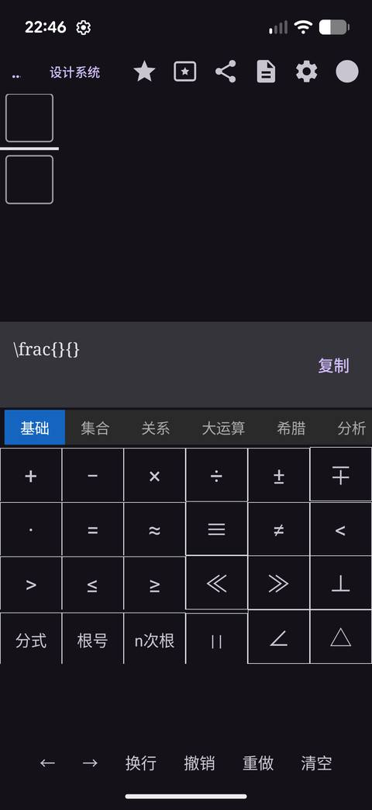
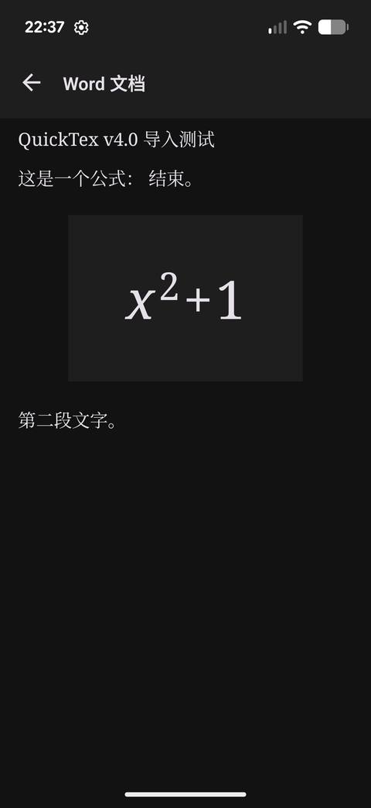
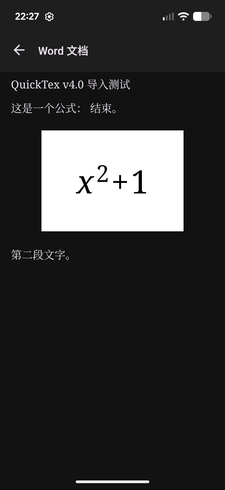

# QuickTex ✨

> **离线 · 可视化 · 印刷级排版**
> Android 平台的 LaTeX 公式编辑器，让公式输入像打字一样自然。
> 已演进为**模块化办公套件**：公式编辑 / 文档渲染 / Office 导入导出 / PDF。

[](https://github.com/Lym20120924/QuickTex)
[](https://developer.android.com/)
[](LICENSE)
[](https://github.com/Lym20120924/QuickTex/releases)

---

## 📸 真机截图

| 公式编辑 | 外观设置中心 | docx 导入 |
|---|---|---|
|  |  |  |

---

## 🧱 架构

```
QuickTex/
├── core/                        内核模块（纯 Kotlin，零 Android 依赖）
│   └── com/formulastudio/
│       ├── app/editor/          公式结构树 / LaTeX 双向转换 / 符号动作
│       ├── core/render/         渲染抽象：RenderTarget + TextStyle + Ink + PathOp + TextMeasurer
│       ├── core/model/          文档块模型：DocBlock（文字/公式/图形/表格）+ DocParser
│       ├── core/export/         Omml（LaTeX→Word 原生公式）、XlsxExporter
│       └── core/doc/            DocxReader（docx → 文字/公式块）
└── app/                         界面 + 渲染后端实现
    └── com/formulastudio/app/
        ├── render/              🖥️ CanvasTarget / 📐 SvgTarget / 📄 PdfTarget
        ├── ui/theme/            Compose 设计系统（Color / Type / Theme）
        ├── ui/components/       可复用设置组件
        ├── editor/              自绘公式编辑器
        ├── doc/                 文档渲染 + 导出
        ├── docx/                Word 文档查看器
        ├── pdf/                 PDF 离线查看
        └── keyboard/            符号键盘
```

**设计原则**

- **内核与平台解耦**：`core` 只做排版与解析，不依赖 Android API → **可单元测试、可复用**
- **渲染可插拔**：内核产出平台无关的绘图意图，由 `RenderTarget` 各后端落地
  （同一份公式 → Canvas / SVG / PDF 效果完全一致）
- **度量抽象**：字体度量走 [`TextMeasurer`](core/src/main/java/com/formulastudio/core/render/TextMeasurer.kt)，
  让排版逻辑得以逐步脱离 `android.graphics.Paint`
- **UI 与引擎分离**：界面只负责输入与交互，排版结果全部来自内核

---

## 🛠️ 技术栈

- Kotlin + Android（minSdk 26 / Android 8.0+，targetSdk 35）
- 公式排版：自研结构树引擎（分数 / 根号 / 上下标 / 矩阵 / cases / 化学方程式）
- 字体：KaTeX 字体（字形级回退）
- 渲染：`RenderTarget` 抽象 + Canvas / SVG / PDF 三后端
- UI：**Jetpack Compose** + Material 3 设计系统（部分旧页面仍为 View）
- 文档渲染：整份 `.tex` → 文本 / 公式 / TikZ / pgfplots 逐块渲染
- 导入导出：**全部零第三方依赖**（手写最小 OOXML）
- 存储：SharedPreferences（收藏 / 历史 / 设置）
- 构建：Gradle 9.7 / AGP 9.3.1 / Kotlin 2.3.21

---

## 📖 目录结构

```
core/src/main/java/com/formulastudio/
├── app/editor/
│   ├── Formula.kt            结构树节点 + 光标模型
│   ├── LatexParser.kt        LaTeX → 结构树
│   ├── LatexSerializer.kt    结构树 → LaTeX
│   ├── FormulaEditorView.kt  布局与绘制（度量走 TextMeasurer）
│   ├── SymbolAction.kt       键盘动作定义
│   └── CmdDisplay.kt         命令 → 显示字符映射
├── core/render/
│   ├── RenderTarget.kt       渲染后端接口 + TextStyle + Ink
│   ├── PathOp.kt             平台无关路径命令
│   └── TextMeasurer.kt       文字度量抽象
├── core/model/
│   ├── DocBlock.kt           文字 / 公式 / 图形 / 表格
│   └── DocParser.kt          文档解析
├── core/export/
│   ├── Omml.kt               LaTeX → Word 原生公式（OMML）
│   └── XlsxExporter.kt       xlsx 写出器
└── core/doc/
    └── DocxReader.kt         docx → 文字 / 公式块

app/src/main/java/com/formulastudio/app/
├── editor/FormulaEditorView.kt  自绘编辑器（屏幕与导出共用排版）
├── render/                      Canvas / SVG / PDF 后端 + 字体注册表
├── doc/                         文档渲染 + 导出（PDF/Word/Excel/Markdown/SVG）
├── docx/DocxViewerActivity.kt   Word 文档查看器
├── pdf/PdfViewerActivity.kt     PDF 离线查看
├── ui/                          Compose 设计系统与页面
└── keyboard/                    符号键盘（9 大分类）
```

---

## 🚀 构建

```bash
export JAVA_HOME="<你的 JDK 17+ 路径>"
./gradlew assembleDebug          # app/build/outputs/apk/debug/app-debug.apk
./gradlew testDebugUnitTest      # 单元测试（app 模块）
./gradlew :core:testDebugUnitTest # 单元测试（core 模块）
```

### 打 release 签名包

1. 生成密钥库（没有就执行）：

```bash
keytool -genkeypair -v -keystore keystore/quicktex-release.jks \
  -keyalg RSA -keysize 2048 -validity 10000 -alias quicktex \
  -storepass <密码> -keypass <密码> \
  -dname "CN=QuickTex Release, OU=FormulaStudio, O=FormulaStudio, C=CN"
```

2. 复制 `keystore.properties.example` 为 `keystore.properties` 并填写
   （两者均已在 `.gitignore` 中，不会上传）

3. `./gradlew assembleRelease` → `app/build/outputs/apk/release/app-release.apk`

---

## ✨ 功能

- 📐 **可视化公式编辑**：分数 / 根号 / 上下标 / 矩阵 / 分段函数 / 化学方程式
- ⌨️ **9 大符号键盘**：基础 · 集合 · 关系 · 大运算 · 希腊 · 分析 · 矩阵 · 上下标 · 系统键盘
- 🔁 **双向同步**：代码框可手改 LaTeX，图形与预览实时联动
- 👆 **点哪去哪**：点虚线占位框或预览对应位置，光标即刻定位
- 📄 **文档渲染**：整份 `.tex` 逐块渲染，支持 TikZ / pgfplots
- 📤 **导出**：PDF · **Word（原生可编辑公式）** · Excel · Markdown · SVG · PNG
- 📥 **导入**：**docx**（含 Word 原生公式）
- 🔍 **查看**：PDF 离线查看
- 🎨 **外观设置中心**：界面风格 / 导航栏 / 配色 / 显示模式（含 AMOLED 纯黑）/ 启动画面
- ⭐ **收藏 & 历史**：搜索、排序、清空
- ↩️ **撤销 / 重做** · 💾 **自动保存** · 🌙 **深色模式** · 🌍 **中英双语**

---

## 📊 质量

- **49 个单元测试全部通过**（`app` + `core` 两个模块）
- 关键重构均做**真机像素对比**验证（例：度量重构后差异 `0.00000%`）

---

## 🗺️ 版本历程

| 版本 | 主题 |
|---|---|
| v2.x | 导出 PDF / Word / Excel / Markdown / SVG |
| v3.0 | Word 原生公式（OMML） |
| v3.1 | OMML 完整化（基于解析树覆盖全部节点类型） |
| v3.2 | 文字度量抽象 `TextMeasurer` |
| v3.3 – v3.4 | 真机验证修复（状态栏 inset / 顶栏溢出 / 文字颜色反转） |
| **v4.0** | **Office 双向：docx 导入查看** |
| v4.1 | 深色渲染适配 |
| **v4.2** | 字体度量统一走接缝（像素级等价） |

---

## ⭕️ 已知限制

- 反向同步以符号键盘覆盖的命令为准；键盘外的复杂手写 LaTeX 会原样显示
- TikZ / pgfplots 仅支持常用子集
- Word 导出中无法转换的公式会回退为**位图**嵌入
- docx 导入目前提取文字与公式，暂不还原版式

---

## 📄 开源协议

- 本应用源码：MIT License（见 LICENSE）
- KaTeX 字体 / 代码：MIT License
- Material Icons：Apache License 2.0

---

*Made with ❤️ for all math lovers.*
